# Anki Advanced

**시험일에 맞춰 복습하고, 카드는 AI가 만들어 주는 Android 간격 반복 학습 앱**

Anki의 SM-2 간격 반복 알고리즘은 그대로 유지하면서, Anki를 쓸 때 가장 불편했던 네 가지를 해결하는 것을 목표로 만든 서울과학기술대학교 컴퓨터공학과 캡스톤디자인 작품입니다.

| 기존 플래시카드 앱의 불편 | Anki Advanced의 해결 |
|---|---|
| 카드를 한 장씩 손으로 만들어야 함 | **AI 카드 자동 생성** — 텍스트나 교재 사진을 넣으면 Gemini가 카드를 만들어 줌 |
| 시험이 3일 남았는데 복습 간격이 30일로 잡힘 | **완주 모드** — 목표 날짜 안에 덱을 끝내도록 복습 간격을 자동으로 압축 |
| 계속 틀리는 카드를 따로 관리할 수 없음 | **약점 카드 감지** — 채점 기록으로 약점 카드를 찾아 모아서 복습 |
| 외국어 외의 분야는 카드 만들기가 어려움 | **유형별 생성** — 일반 개념·코드·수식·연표·사용자 지정 유형 |

모든 데이터는 기기 안(Room DB)에 저장되며, 인터넷은 AI 카드 생성에만 사용합니다.

## 화면 구성

| 화면 | 할 수 있는 일 |
|---|---|
| 홈 | 오늘 학습 진행률, 덱 목록(신규 · 학습 중 · 복습 카드 수, 약점 N개, 완주 모드 배지와 만기일), 연속 학습 일수, 총 암기한 카드 수, 덱 추가, AI로 덱 자동 생성 |
| 덱 메뉴 | 카드 관리, 설정(하루 새 카드 · 복습 한도), 완주 모드 설정/수정, 일반 모드로 전환, 덱 삭제 |
| 카드 관리 | 카드 추가 · 수정 · 삭제, 앞면 · 뒷면 · 태그 검색 |
| 학습 | 카드 뒤집기, 4단계 채점(버튼마다 실제 다음 간격 표시), 되돌리기, 진행률 표시, 약점 배지 |
| 약점 카드 복습 | 약점 카드만 점수 높은 순으로 모아 학습 |
| 완주 모드 설정 | 캘린더로 목표 날짜 선택, 기간 프리셋(7 · 14 · 30 · 60 · 90일), 종료 예정일과 하루 학습량 미리보기 |
| AI로 덱 만들기 | 제목 · 내용 · 사진(촬영 또는 갤러리), 카드 수(1~30), 카드 언어, 카드 유형과 세부 형태 선택, 생성 결과 미리보기 · 제외 · 덱 이름 수정 후 저장 |
| 퓨샷 예시 설정 | 기본 유형별 내 예시 추가, 사용자 지정 유형 만들기 |

### 덱 · 카드 관리

| 덱 추가 | 덱 메뉴 | 카드 관리 |
|---|---|---|
| 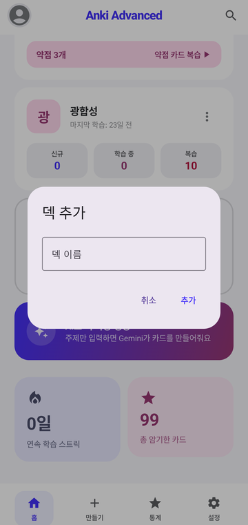 | 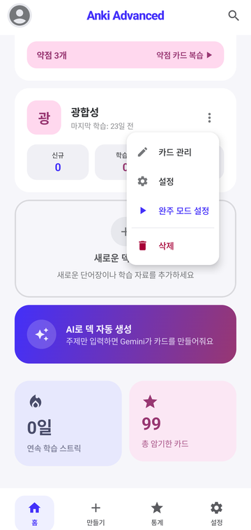 | 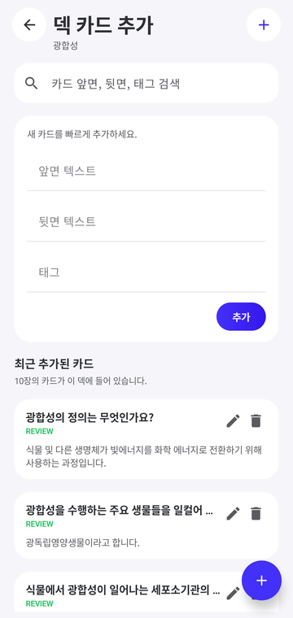 |

---

## 주요 기능

### 1. 간격 반복 학습 (SM-2)

카드 앞면을 보고 답을 떠올린 뒤 **다시 · 어려움 · 좋음 · 쉬움** 중 하나로 채점하면 다음 복습 날짜가 자동으로 정해집니다. 버튼 위에는 그 버튼을 눌렀을 때 카드가 실제로 다시 나오는 시간(예: 10분, 6일)이 표시됩니다.

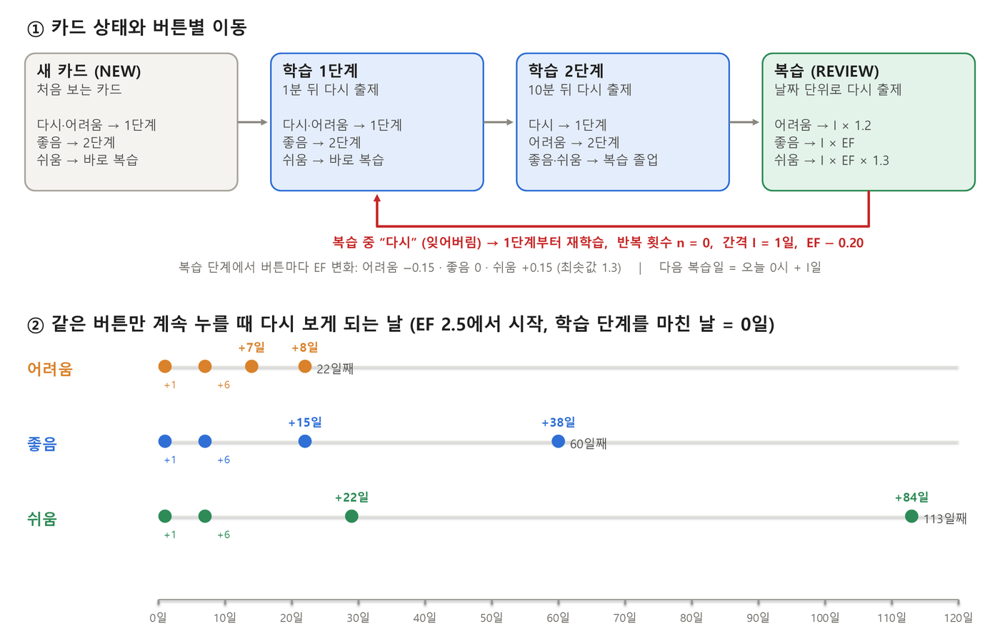

- 카드 상태: **NEW → LEARNING(1분 · 10분 단계) → REVIEW(날짜 단위)**
- 간격: `I(1) = 1일`, `I(2) = 6일`, `I(n) = I(n-1) × EF` (n ≥ 3)
- 난이도 계수: `EF' = max(1.3, EF + ΔEF)`

원래 SM-2(SuperMemo, 1987)와 다른 점 — Anki 방식을 참고해 휴대폰에서 쓰기 편하게 바꿨습니다.

| 항목 | 원래 SM-2 | 이 앱 |
|---|---|---|
| 채점 | 0~5점 6단계 | 버튼 4개 (SM-2 점수 0·3·4·5에 대응) |
| EF 변화 | 공식 계산 (어려움 −0.14, 쉬움 +0.10) | 고정값 (어려움 −0.15, 좋음 0, 쉬움 +0.15) |
| 어려움 간격 | 간격 × EF | 간격 × 1.2 |
| 쉬움 간격 | 간격 × EF | 간격 × EF × 1.3 (보너스) |
| 새 카드 | 학습 단계 없음 | 1분 · 10분 학습 단계를 거쳐 졸업 |
| 잊어버린 카드 | 처음부터 다시 | 학습 단계로 돌아가 재학습, n = 0, I = 1일, EF − 0.20 |
| 복습 시각 | — | 자정 기준 날짜 단위 |
| 출제 순서·한도 | — | LEARNING → REVIEW → NEW, 덱별 하루 한도(새 카드 10 · 복습 50) |
| 되돌리기 | — | 직전 채점 취소 (카드 상태와 채점 기록 모두 복구) |

| 홈 | 학습 (앞면) | 학습 (뒷면 · 채점) | 학습 완료 |
|---|---|---|---|
| 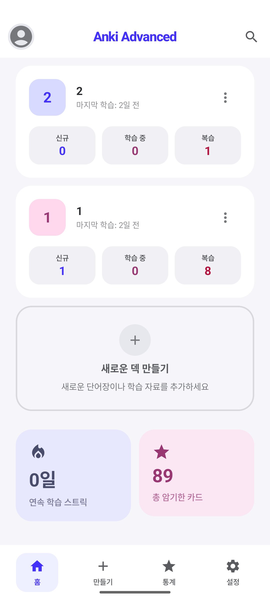 | 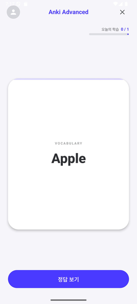 | 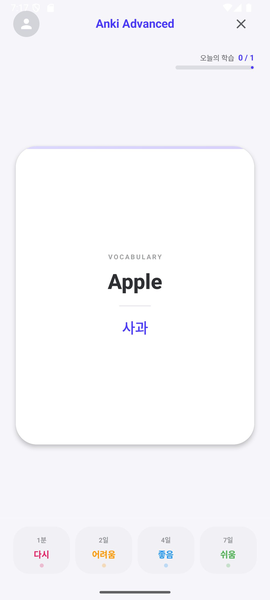 | 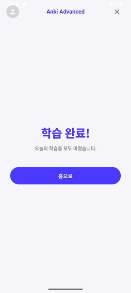 |

### 2. 완주 모드 (Completion Mode)

덱마다 목표 종료 날짜를 정하면, 그 날짜 안에 덱을 끝낼 수 있도록 SM-2 간격을 비율에 맞게 줄입니다.

```
ratio    = clamp( W(목표 기간) / W(덱의 최대 REVIEW 간격), 0.01, 1.0 )
실제 간격 = SM-2 간격 × U(0.9, 1.1) × ratio
```

- 상한을 1.0으로 두어 기간이 넉넉해도 간격이 원래보다 길어지지 않습니다.
- ±10% 무작위 흔들림으로 같은 날 배운 카드가 같은 날에 몰리지 않습니다.
- 학습 단계(1분 · 10분)도 `ratio × 0.5`만큼 줄이되 최소 10초 · 1분은 보장합니다.
- 밀린 카드는 밀린 비율로 우선순위(URGENT · HIGH · NORMAL)를 매기고, 세션당 카드 수는 `⌈남은 카드 ÷ 남은 세션⌉`입니다.
- 기간을 바꾸면 카드별 진행도(지난 시간 ÷ 원래 간격)는 유지한 채 다음 복습 시각만 다시 계산합니다. 예를 들어 30일 계획의 15일째는 7일 계획의 3.5일째가 됩니다.
- 덱 메뉴의 **일반 모드로 전환**으로 언제든 완주 모드를 끌 수 있고, 그때까지의 학습 일정은 유지됩니다.
- 모드가 끝나면 학습 밀도와 정답률로 간격을 보정해 일반 모드로 돌아갑니다(α = 0.5, β = 0.2).

| 덱 배지 | 완주 모드 메뉴 | 목표 날짜 선택 | 설정 완료 | 완주 모드 학습 |
|---|---|---|---|---|
| 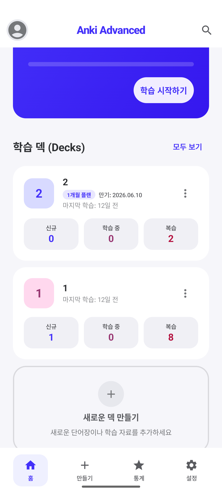 | 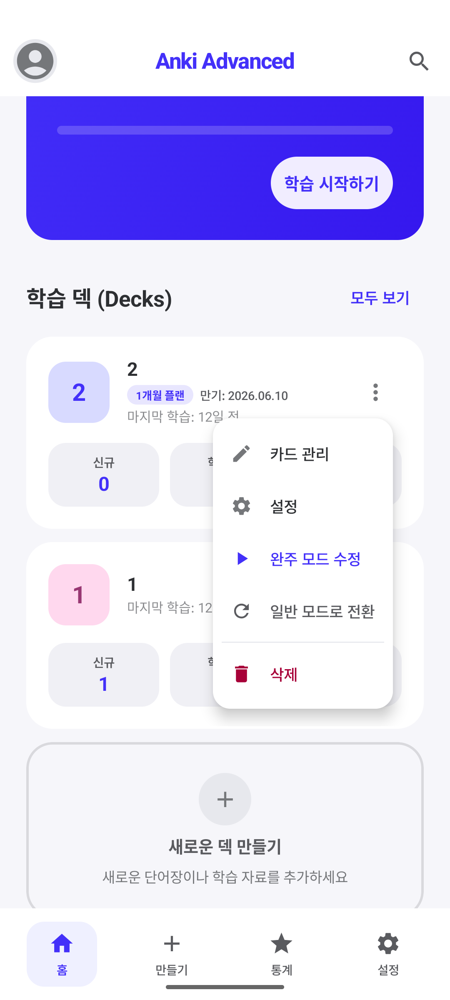 | 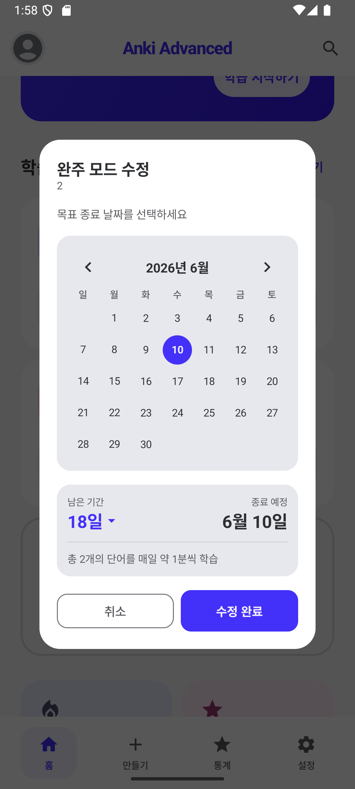 | 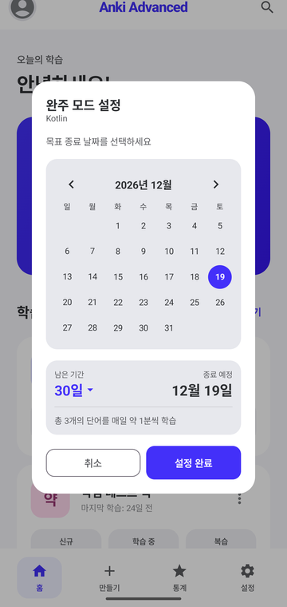 | 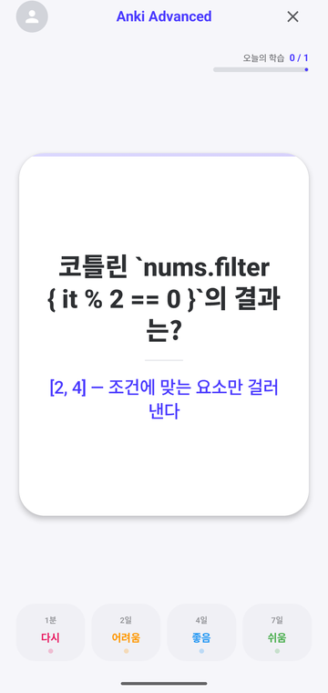 |

### 3. AI 카드 자동 생성 (Gemini)

덱 제목, 내용(텍스트 또는 교재 사진), 카드 수를 입력하면 Gemini가 카드를 만들어 줍니다. 생성된 카드는 미리보기에서 확인하고 필요 없는 카드를 뺀 뒤 덱으로 저장합니다.

| 사진으로 자료 입력 | 생성 결과 미리보기 |
|---|---|
| 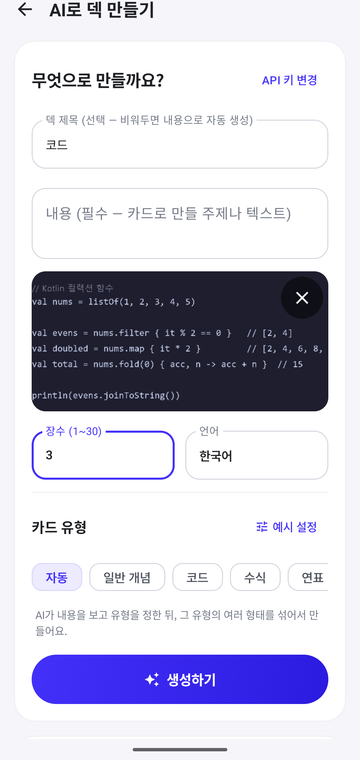 | 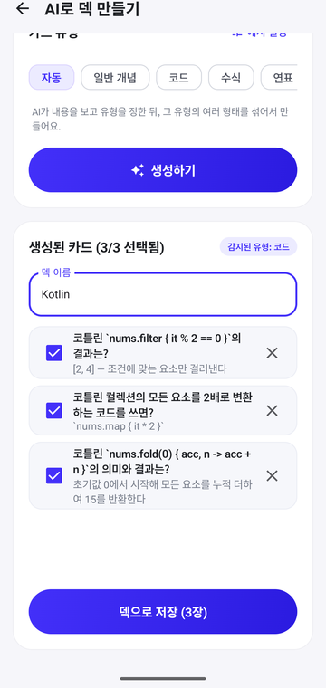 |

**2단계 생성**

1. **유형 분류** — 유형을 "자동"으로 두면 Gemini가 자료를 읽고 `{"type": "fact" | "code" | "formula" | "timeline"}` 하나만 돌려줍니다.
2. **유형별 생성** — 시스템 지시문(유형 · 작성 지침)과 유형별 퓨샷 예시 5쌍을 user/model 턴으로 번갈아 넣고, 실제 자료를 마지막 user 턴으로 보냅니다. `responseMimeType: application/json` + `responseSchema`로 응답 형식을 고정합니다.

**유형별 생성 예시** (같은 조건: 카드 3장, 유형 자동 — 네 경우 모두 유형을 맞게 분류)

| 유형 | 세부 형태 | 예시 결과 |
|---|---|---|
| 일반 개념 | 개념 맞히기 / 개념 설명하기 | 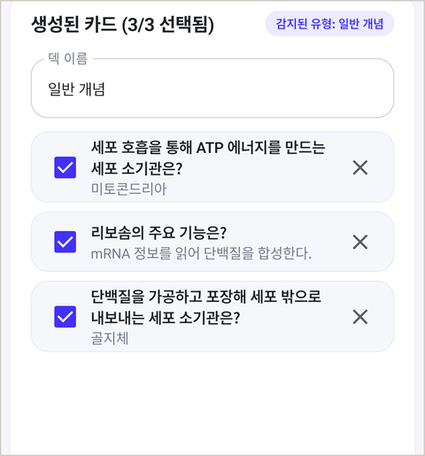 |
| 코드 | 코드 작성 / 문법 의미 | 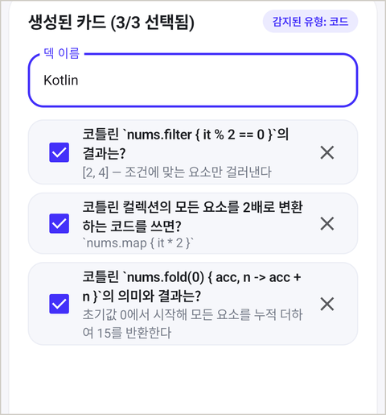 |
| 수식 | 수식 계산 / 개념 · 공식 | 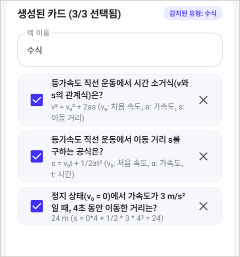 |
| 연표 | 연도 / 사건 순서 | 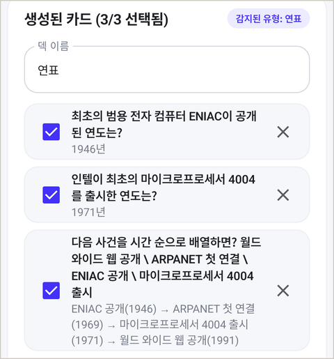 |
| 사용자 지정 | 사용자가 정한 이름 · 지침 · 예시 | 퓨샷 예시 설정 화면에서 추가 |

- 카드 언어(예: 한국어)와 카드 수(1~30장)를 정할 수 있고, 덱 제목을 비워 두면 내용에 맞춰 자동으로 붙습니다.
- 유형을 직접 고르면 그 유형의 세부 형태를 하나 또는 둘 다 골라 만들 수 있습니다.
- 기본 유형마다 내 예시를 추가하거나, 새 유형(이름 · 작성 지침 · 예시)을 직접 만들 수 있습니다.
- Gemini 서버가 혼잡(503 · 429)하면 5초 · 15초 · 45초 간격으로 자동 재시도합니다.
- API 키는 사용자가 직접 입력하며 기기 안에 AES-256으로 암호화해 저장합니다(EncryptedSharedPreferences).

| 퓨샷 예시 설정 |
|---|
| 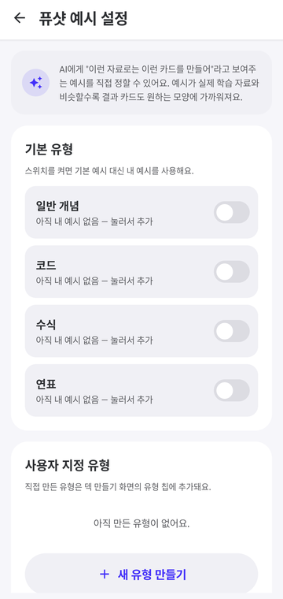 |

### 4. 약점 카드 감지

AI 모델 없이 채점 기록(review_logs)만으로 자주 틀리는 카드를 찾습니다.

```
weakScore = 0.5 × min(lapse, 8) / 8  +  0.5 × Σ 0.8^i · f_i / Σ 0.8^i   (i = 0..7, 최근 8회)
```

- `lapse`: REVIEW 단계에서 다시를 누른 횟수 (처음 배울 때 틀린 것은 세지 않음)
- `f_i`: 최근 채점의 실패 값 (다시 1, 어려움 0.5, 좋음 · 쉬움 0), 최근일수록 가중치가 큼
- 채점 4회 미만은 판정하지 않고, lapse 8회 이상이면 바로 약점, 그 외에는 점수 0.6 이상이면 약점
- 홈 화면 덱에 "약점 N개"가 표시되고, **약점 카드 복습**을 누르면 점수가 높은 카드부터 학습합니다. 일반 학습 중에도 약점 카드에는 "약점" 배지가 붙습니다.

| 덱의 약점 표시 | 약점 카드 복습 |
|---|---|
| 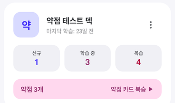 | 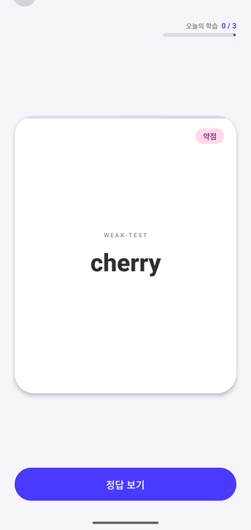 |

---

## 기술 스택

| 항목 | 내용 |
|---|---|
| 플랫폼 | Android (minSdk 24, targetSdk 36) |
| 언어 · UI | Kotlin 2.0, Jetpack Compose (Material 3) |
| 구조 | MVVM — Compose 화면 · ViewModel(StateFlow) · Room DB |
| 로컬 DB | Room 2.6.1 (DB 버전 3, 마이그레이션 1→2→3) |
| AI | Google Gemini API (`gemini-3.5-flash-lite`), OkHttp |
| 보안 | EncryptedSharedPreferences (API 키 저장) |
| 테스트 | JUnit 단위 테스트 (약점 카드 판정, 채점 버튼 간격 표시) |

```
Compose 화면 ──▶ ViewModel (StateFlow) ──▶ Room DB (cards · decks · review_logs · completion_mode_configs)
                       │
                       └──▶ Gemini API (AI 카드 생성 시에만)
```

계산 로직(SM-2 간격, 완주 모드 압축, 약점 판정)은 순수 Kotlin 함수로 분리해 기기 없이 단위 테스트할 수 있게 했습니다.

| 파일 | 내용 |
|---|---|
| `StudyViewModel.kt` | 일반 학습 흐름과 SM-2 계산 |
| `completion/CompletionAlgorithm.kt` | 완주 모드 압축 비율, 간격, 세션, 모드 종료 보정 |
| `gemini/GeminiDeckGenerator.kt` | 유형 분류 · 유형별 카드 생성 프롬프트 |
| `weak/WeakCardDetector.kt` | 약점 점수 계산과 판정 |
| `Appdatabase.kt` | Room DB 싱글턴과 마이그레이션 |

## 데이터베이스

Room DB(`anki.db`, 버전 3)는 테이블 4개로 구성됩니다.

| 테이블 | 주요 컬럼 | 용도 |
|---|---|---|
| `cards` | deckId, front, back, tags, status(NEW · LEARNING · REVIEW), state(마지막 채점), repetition, intervalDays, easeFactor, nextReviewAt, learningStep, baseInterval, lastReviewAt, cardType | 카드 내용과 SM-2 · 완주 모드 상태 |
| `decks` | name, dailyNewLimit(기본 10), dailyReviewLimit(기본 50) | 덱 목록과 하루 한도 |
| `review_logs` | deckId, cardId, score(0~3), sm2Q(0 · 3 · 4 · 5), reviewedAt, isNewAtReview | 채점 기록 — 진행률, 연속 학습, 약점 판정에 공통으로 사용 |
| `completion_mode_configs` | deckId, targetPeriodMs, windowStartHour, windowEndHour, modeStartAt, sessionIntervalMs, isActive | 덱별 완주 모드 설정 |

## 프로젝트 구조

```
app/src/main/java/com/example/anki_advanced/
├── HomeActivity.kt, HomeScreen.kt, HomeViewModel.kt     홈 화면과 화면 이동(Navigation)
├── StudyScreen.kt, StudyViewModel.kt                     일반 학습 · 약점 카드 복습, SM-2 계산
├── DeckManageScreen.kt, DeckManageViewModel.kt           카드 관리
├── DeckSettingActivity.kt                                덱별 하루 한도 설정
├── GradeHint.kt                                          채점 버튼 간격 표시
├── Appdatabase.kt, *Entity.kt, *Dao.kt                   Room DB
├── completion/                                           완주 모드 (알고리즘, 설정 화면, 학습 화면, 허용 시간 계산)
├── gemini/                                               AI 카드 생성 (프롬프트, 퓨샷 예시, API 키 저장, 이미지 처리)
└── weak/                                                 약점 카드 판정
app/src/test/java/com/example/anki_advanced/              단위 테스트
```

## 실행 방법

1. Android Studio로 프로젝트를 열고 `app`을 실행합니다. (Android 7.0 이상, 카메라 입력을 쓰려면 카메라 권한 허용)
2. AI 카드 생성을 쓰려면 앱의 **AI로 덱 만들기** 화면에서 본인의 Gemini API 키를 입력합니다([Google AI Studio](https://aistudio.google.com/)에서 무료 발급).
3. 단위 테스트: `./gradlew :app:testDebugUnitTest`

## 현재 한계

- 하단 탭의 **통계 · 설정**은 아직 버튼만 있고 화면이 없습니다.
- 완주 모드의 하루 학습 허용 시간대는 알고리즘과 DB에는 있지만, 설정 화면이 없어 하루 전체(0~24시)로 동작합니다.
- 데이터베이스 마이그레이션이 빠졌을 때 데이터를 초기화하는 설정(`fallbackToDestructiveMigration`)이 남아 있습니다.
- AI가 만든 카드는 틀린 내용이 있을 수 있어, 저장 전에 미리보기에서 확인하도록 했습니다.

## 앞으로 할 일

- 기기 간 동기화 (계정 · 클라우드 백업)
- 오버레이 학습 (다른 앱 위에 카드 표시)
- 압박 모드 (제한 시간 + 되돌리기 없음)
- 통계 화면(학습량 · 정답률 · 망각곡선)과 복습 알림
- 설정 화면과 완주 모드 허용 시간대 설정
- 배포 전 `fallbackToDestructiveMigration` 제거
